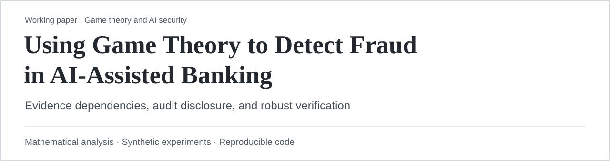
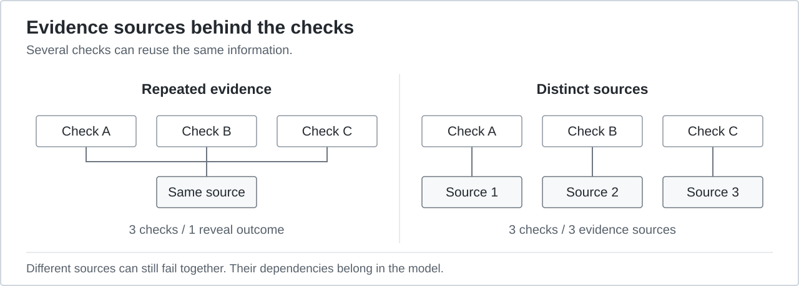
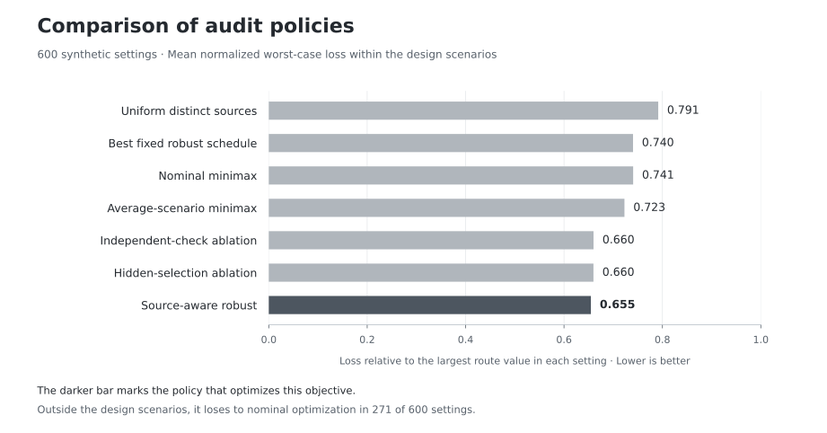

<p align="center">
  
</p>

<p align="center">
  <strong>Three AI agents can agree while relying on the same weak evidence.</strong><br>
  How should a bank spend a limited audit budget when checks share sources<br>
  and an attacker may learn which check was selected?
</p>

<p align="center">
  <a href="using_game_theory_to_detect_fraud_in_ai_assisted_banking.pdf"><strong>Read the paper ↗</strong></a>
  &nbsp; · &nbsp;
  <a href="#the-30-second-idea">The idea</a>
  &nbsp; · &nbsp;
  <a href="#what-the-experiments-show">Results</a>
  &nbsp; · &nbsp;
  <a href="#run-it-yourself">Run the study</a>
</p>

<table>
  <tr>
    <td align="center"><strong>600</strong><br>synthetic settings</td>
    <td align="center"><strong>7</strong><br>audit policies</td>
    <td align="center"><strong>300</strong><br>estimation experiments</td>
    <td align="center"><strong>4,523</strong><br>optimizations checked</td>
  </tr>
</table>

> **The core idea:** Track where evidence comes from. Allocate checks to account for repeated information, shared failures, and possible audit disclosure.

This is a **theoretical working paper with reproducible synthetic experiments**. It does not report live AI-agent tests, bank transactions, or measured fraud reductions.

## The 30-second idea

Imagine three checks that all reuse the same invoice-verification outcome. Counting them as three independent chances to catch a problem overstates what the checks can do.

The paper models the **sources behind the checks**, then chooses an audit policy under a hard budget. It also accounts for sources failing together and for an attacker discovering the selected audit.

<p align="center">
  
</p>

A second inspection can add value if it reveals new information. The model distinguishes that from reusing the same outcome. Mandatory authorization and compliance checks remain outside this optimization.

## What the paper adds

| Result | Why it matters |
| :--- | :--- |
| **A proof of failure from false independence** | In a constructed family, treating repeated evidence as independent can produce arbitrarily worse allocations than the source-aware optimum. |
| **Exact changes as audits become exposed** | A three-route example identifies when the best audit policy changes as disclosure becomes more likely. |
| **Bounds for uncertain evidence** | Estimation-error and finite-sample results connect uncertainty in the loss model to bounds on policy performance. |
| **A reproducible comparison** | Seven policies are compared across 100 evidence graphs, two budgets, and three disclosure levels, including an omitted adverse scenario. |

The contribution combines evidence-source modeling with robust audit allocation and disclosure analysis. The underlying optimization and concentration tools build on established work; the manuscript discusses that relationship explicitly.

## What the experiments show

<p align="center">
  
</p>

The source-aware policy has the lowest mean loss **on the worst-case objective it is designed to optimize**. That outcome is expected by construction. The comparisons help quantify the effects of the modeling assumptions.

**Where it breaks:** in an adverse scenario excluded from policy design, the robust policy performs worse than nominal optimization in **271 of 600 settings**. Its design-envelope loss bound is exceeded in **430 of 600 settings**. The guarantee depends on the modeled scenarios and assumptions.

<details>
<summary><strong>Open the full comparison table</strong></summary>

Both columns report mean normalized loss; lower is better. Values are rounded to three decimal places.

| Policy | Within design scenarios | Omitted adverse scenario |
| :--- | ---: | ---: |
| Uniform distinct sources | 0.791 | 0.815 |
| Best fixed robust schedule | 0.740 | 0.751 |
| Nominal minimax | 0.741 | 0.731 |
| Average-scenario minimax | 0.723 | **0.716** |
| Independent-check ablation | 0.660 | 0.732 |
| Hidden-selection ablation | 0.660 | 0.736 |
| Source-aware robust | **0.655** | 0.730 |

The ablations deliberately remove dependence or disclosure modeling to measure its effect. Each of the 100 generated graphs contributes six related settings; these are not 600 independent real-world observations.

[Full policy results](results/extended/all_policy_results.csv) · [Summary data](results/extended/summary.json) · [Study design and seeds](REPRODUCING.txt)

</details>

## Run it yourself

Use **Python 3.12+**. From the repository root on Linux or macOS:

```bash
python3 -m venv .venv
.venv/bin/python -m pip install -r analysis/requirements.txt
.venv/bin/python analysis/evidence_audit.py
```

The study regenerates `results/extended/`. It needs **no API keys, model downloads, or bank data**. Each defender optimization is checked against a separately solved attacker dual.

<details>
<summary><strong>Build the PDF, verify the files, or regenerate these visuals</strong></summary>

**Build the manuscript.** Install `pdflatex` and `bibtex` with the LaTeX packages used in the source, then run:

```bash
.venv/bin/python analysis/build_paper.py
```

To build from the results already included:

```bash
.venv/bin/python analysis/build_paper.py --skip-compute
```

**Verify the artifacts.** Install `pdftotext` from Poppler, then run:

```bash
python3 analysis/verify_artifacts.py
```

This checks stored source/result hashes, numerical summaries, bibliography keys, and PDF text. When a LaTeX build log is present, it also checks unresolved references and horizontal overflow. Local reports go in `results/build/`, which Git ignores.

**Reproduce the original three-route example:**

```bash
.venv/bin/python analysis/audit_game.py
```

**Regenerate the README visuals:**

```bash
.venv/bin/python analysis/render_readme_assets.py
```

The cover and evidence diagram use simple SVG shapes and text on white backgrounds. Matplotlib draws the grayscale results chart directly from `results/extended/summary.json`. No AI image generation is used.

The recorded study used Python 3.14.4. PyMuPDF is used to remove PDF metadata. Numerical tolerances allow small platform differences; PDF bytes can vary between runs. Export scripts remove embedded metadata. See [REPRODUCING.txt](REPRODUCING.txt) for the full environment and assumptions.

</details>

## Contribution and AI disclosure

**Prompted by Nariman Orujov.** All other aspects of the work and paper preparation were carried out by AI agents.

## Explore the repository

| Start here | What you will find |
| :--- | :--- |
| [Paper PDF](using_game_theory_to_detect_fraud_in_ai_assisted_banking.pdf) | Full argument, proofs, experiments, and limitations |
| [LaTeX source](using_game_theory_to_detect_fraud_in_ai_assisted_banking.tex) · [Bibliography](references.bib) | Editable manuscript and cited work |
| [Main experiment](analysis/evidence_audit.py) | Evidence model, optimization, comparisons, and numerical checks |
| [Results](results/extended/) | Generated inputs, CSVs, tables, figures, and SHA-256 manifest |
| [Reproduction guide](REPRODUCING.txt) | Seeds, dependencies, assumptions, and verification steps |
| [Visual assets](assets/) · [Renderer](analysis/render_readme_assets.py) | Local SVGs and the code that creates them |

---

<p align="center">
  <strong>Using Game Theory to Detect Fraud in AI-Assisted Banking</strong><br>
  <em>Evidence Dependencies, Audit Disclosure, and Robust Verification in Agent-Assisted Banking</em><br><br>
  <a href="using_game_theory_to_detect_fraud_in_ai_assisted_banking.pdf"><strong>Read the full paper ↗</strong></a>
</p>
